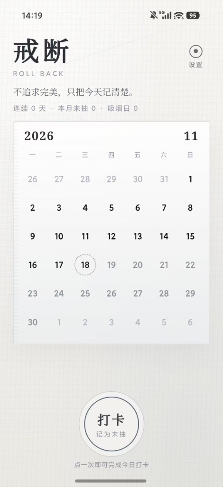
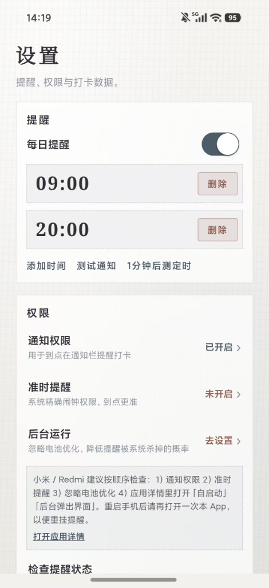

<p align="center">
  
</p>

<h1 align="center">Jieduan · ROLL BACK</h1>

<p align="center">
  <a href="./README.md">中文</a> · <strong>English</strong>
</p>

<p align="center">A fully offline quit-smoking check-in app (uni-app / Vue 3). No network, no account — all data stays on device.</p>

## Screenshots

| Home | Settings |
|:---:|:---:|
|  |  |

## Features

- Daily check-in: smoke-free / smoked (optional cigarette count), streak and monthly stats
- Month calendar: swipe to change month; tap to view, long-press to edit
- Local reminders: Android exact alarms + notification bar (off by default; user must enable)
- Import / export: share or download JSON; optional password encryption; merge or overwrite import
- Automatic local backup: configurable interval (default 7 days), written to the app private directory

## Stack

- uni-app (Vue 3)
- Target: Android App (H5 can preview check-in; reminders are App-only)
- Local storage: `uni.setStorageSync`

## Layout

```
├── App.vue                 # Boot, system bars, reminder re-schedule
├── pages/index/            # Home (Settings opens as same-page fullscreen panel)
├── components/
│   ├── SettingsPanel.vue   # Settings panel
│   ├── GuideSteps.vue      # First-run light guide
│   ├── MonthCalendar.vue   # Calendar + gestures
│   ├── PaperDialog.vue     # Confirm / ActionSheet
│   └── InkSplash.vue       # In-page splash
├── mixins/
│   └── paperDialog.js      # Shared dialog logic
├── utils/
│   ├── storage.js          # Storage (cache + write guard)
│   ├── checkin-stats.js    # Streak / month stats cache
│   ├── times.js            # Reminder time normalization
│   ├── permissions.js      # Notification / exact alarm / battery
│   ├── export.js           # JSON import / export
│   ├── systemui.js         # Status / nav bar paper theme
│   ├── platform.js         # App / H5 detection
│   └── notify/             # Local reminders (channel / alarm / receivers)
├── nativeplugins/JieduanBoot/  # Optional: boot static Receiver sources
└── common/theme.scss
```

## Run locally

1. Open this project folder in [HBuilderX](https://www.dcloud.io/hbuilderx.html)
2. Run on an Android device / emulator (custom debug base)
3. Release: Issue → Native App — cloud / local packaging

## Reminder reliability (important)

Android clears `AlarmManager` alarms after reboot. This project uses:

| Layer | Approach |
|------|----------|
| Process alive | Dynamic `BroadcastReceiver` + `setExactAndAllowWhileIdle` |
| Process killed | `setAlarmClock` + Activity fallback |
| Device reboot | Re-schedule on every foreground; open the app once after reboot. Optional `JieduanBoot` for boot launch |

OEM (especially Xiaomi) also needs: notification permission, exact alarms, ignore battery optimization, auto-start. Settings includes first-enable guidance, “check reminder status”, and device tips.

Optional native plugin: `nativeplugins/JieduanBoot/` (build the AAR yourself; see that folder’s README).

## Data format

Export JSON example:

```json
{
  "app": "jieduan",
  "version": 1,
  "exportedAt": "2026-01-01T00:00:00.000Z",
  "checkins": {
    "2026-01-01": {
      "date": "2026-01-01",
      "status": "success",
      "cigs": 0,
      "updatedAt": 0
    }
  }
}
```

`status`: `success` (smoke-free) | `fail` (smoked)

## Privacy

- No collection, no upload, no analytics SDK
- All data stays on device; uninstall deletes it (export first)

## License

MIT
