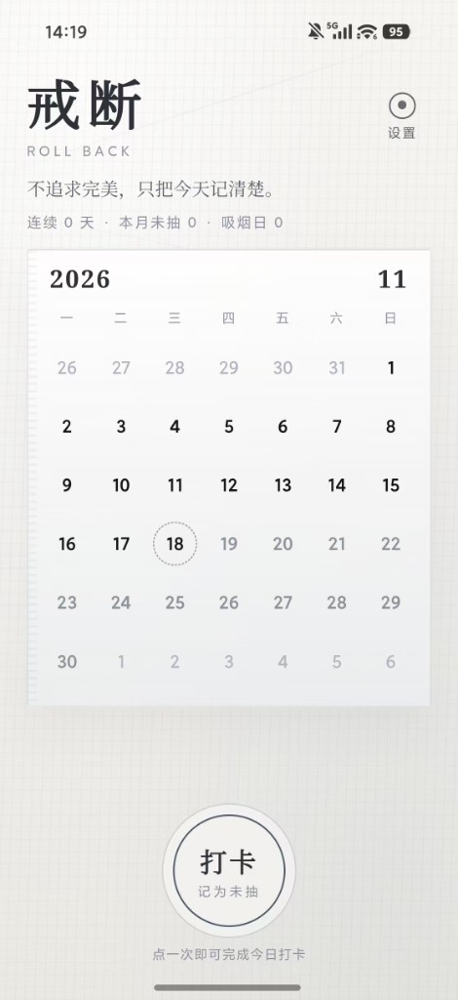
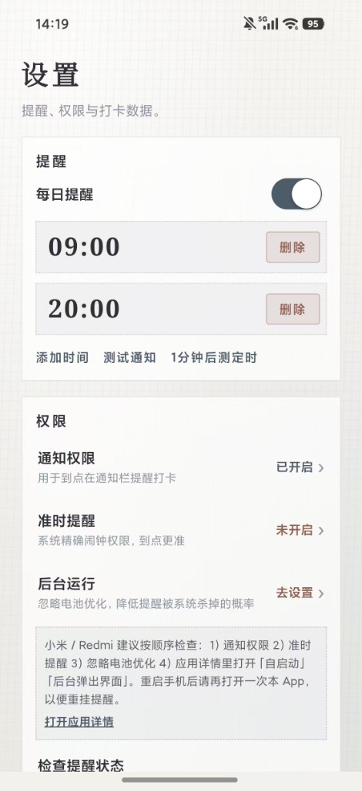

<p align="center">
  
</p>

<h1 align="center">戒断 · ROLL BACK</h1>

<p align="center">
  <strong>中文</strong> · <a href="./README.en.md">English</a>
</p>

<p align="center">纯本地戒烟打卡 App（uni-app / Vue3）。不联网、无账号，数据存在本机。</p>

## 界面预览

| 首页 | 设置 |
|:---:|:---:|
|  |  |

## 功能

- 按日打卡：未抽 / 已吸烟（可计支数），连续天数与本月统计
- 月历浏览：左右滑切换月份；点选查看，长按直接修改
- 本地提醒：Android 精确闹钟 + 通知栏（默认关闭，需用户主动开启）
- 导入导出：JSON 分享 / 下载；可选密码加密；合并或覆盖导入
- 自动本地备份：可按天数设置周期（默认 7 天），写入 App 私有目录

## 技术栈

- uni-app（Vue 3）
- 目标平台：Android App（H5 可预览打卡，提醒能力仅 App）
- 本地存储：`uni.setStorageSync`

## 目录结构

```
├── App.vue                 # 启动、系统栏、提醒重挂
├── pages/index/            # 打卡首页（设置以同页全屏面板打开）
├── components/
│   ├── SettingsPanel.vue   # 设置面板
│   ├── GuideSteps.vue      # 首次分步轻引导
│   ├── MonthCalendar.vue   # 月历与手势
│   ├── PaperDialog.vue     # 确认框 / ActionSheet
│   └── InkSplash.vue       # 页内开屏
├── mixins/
│   └── paperDialog.js      # 对话框共用逻辑
├── utils/
│   ├── storage.js          # 存储（缓存 + 写保护）
│   ├── checkin-stats.js    # 连续天数 / 月统计缓存
│   ├── times.js            # 提醒时间规范化
│   ├── permissions.js      # 通知 / 精确闹钟 / 电池优化
│   ├── export.js           # JSON 导入导出
│   ├── systemui.js         # 状态栏 / 导航栏纸色
│   ├── platform.js         # App / H5 环境判断
│   └── notify/             # 本地提醒（channel / alarm / receivers）
├── nativeplugins/JieduanBoot/  # 可选：开机静态 Receiver 源码
└── common/theme.scss
```

## 本地运行

1. 用 [HBuilderX](https://www.dcloud.io/hbuilderx.html) 打开本项目目录
2. 运行到 Android 真机 / 模拟器（调试基座）
3. 正式包：发行 → 原生 App-云打包 / 本地打包

## 提醒可达性说明（重要）

Android 会在重启后清空 `AlarmManager` 闹钟。本项目策略：

| 层级 | 做法 |
|------|------|
| 进程存活 | 动态 `BroadcastReceiver` + `setExactAndAllowWhileIdle` |
| 进程被杀 | `setAlarmClock` + Activity 拉起兜底 |
| 手机重启 | 每次回前台都会重挂；重启后请再打开一次 App。可选接入 `JieduanBoot` 开机拉起 |

厂商（尤其小米）还需：通知权限、精确闹钟、忽略电池优化、自启动。设置里提供首次开启引导、「检查提醒状态」与机型说明。

可选原生插件见 `nativeplugins/JieduanBoot/`（需自行打 AAR；说明见该目录 README）。

## 数据格式

导出 JSON 示例：

```json
{
  "app": "jieduan",
  "version": 1,
  "exportedAt": "2026-01-01T00:00:00.000Z",
  "checkins": {
    "2026-01-01": {
      "date": "2026-01-01",
      "status": "success",
      "cigs": 0,
      "updatedAt": 0
    }
  }
}
```

`status`：`success`（未抽）| `fail`（已吸烟）

## 隐私

- 不采集、不上传、无统计 SDK
- 全部数据在设备本地；卸载即丢失（请先导出）

## License

MIT
